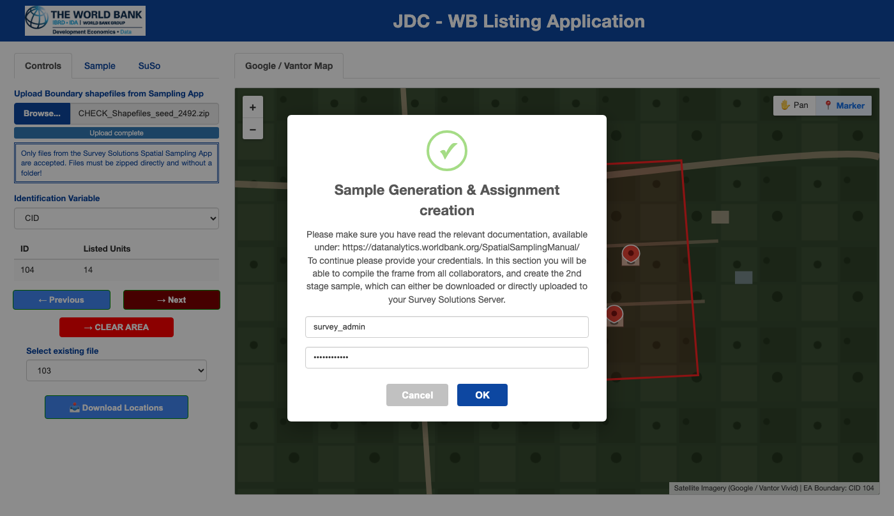
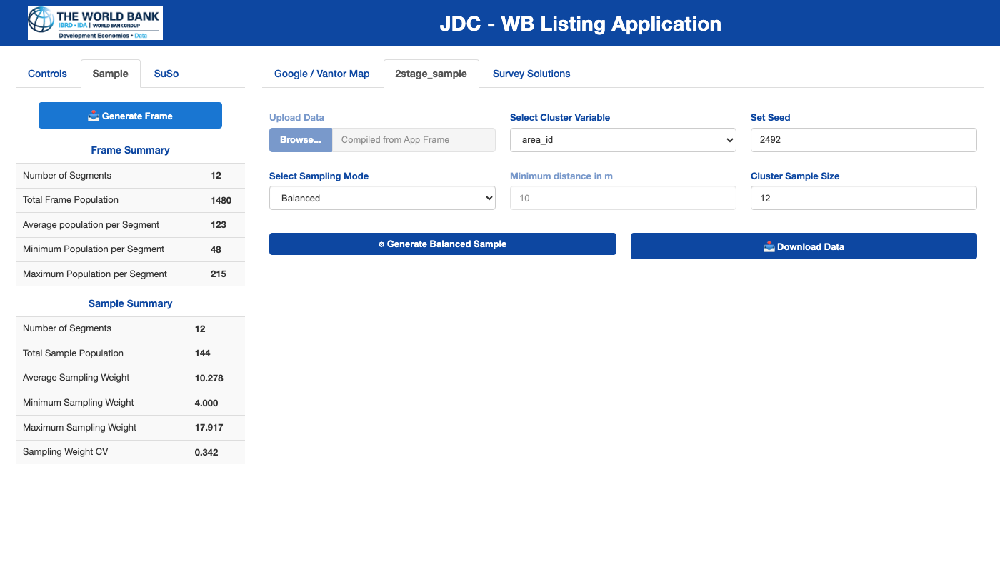

```{r, include = FALSE}
knitr::opts_chunk$set(
  collapse = TRUE,
  comment = "#>",
  out.width = "100%"
)
```

## Overview

When working with a team of desk enumerators, `susolisting` provides an integrated **Administrator Workflow** to:

1. **Compile the Building Frame**: Scan all enumerator working directories and combine their per-cluster `.fst` files into a unified, ordered second-stage sampling frame.
2. **Draw a Second-Stage Sample**: Select a fixed number of buildings per cluster using either **Spatially Balanced Sampling (GRTS)**—with or without a minimum distance constraint in meters—or **Simple Random Sampling (IRS)** powered by the [`spsurvey`](https://usepa.github.io/spsurvey/) package.
3. **Export or Assign**: Download the sampled building units as a zipped CSV or proceed directly to the **Survey Solutions** tab to create field supervisor assignments.

---

## 1. Launching the Application in Administrator (Team) Mode

To enable the administrator modules (**Sample** and **SuSo** tabs) and prevent individual enumerators from flushing the `.fst` working directories via the local download button, start the application with `admuser` and `admpass`:

```r
library(susolisting)

# Interactive session with Google Maps (default, 10x10 spatial coverage grid)
runListingApp(
  admuser = "survey_admin",
  admpass = "your_secure_password",
  provider = "google",
  n_grid = 10L
)

# Interactive session with Vantor / Maxar imagery
runListingApp(
  admuser = "survey_admin",
  admpass = "your_secure_password",
  provider = "vantor",
  n_grid = 10L
)
```

On a **Shiny Server** deployment, place the following in `app.R`:

```r
library(susolisting)
susolisting::runListingAppServer(
  admuser = "survey_admin",
  admpass = "your_secure_password",
  provider = "google",
  n_grid = 10L
)
```

### Collecting Enumerator Files

- If enumerators work on a shared Shiny Server or the same machine, their `<User_Name>_<Shapefile_Name>/area_<ID>.fst` folders are automatically stored in the application's data directory:
  ```r
  file.path(tools::R_user_dir("susolisting", which = "data"), "download")
  ```
- If enumerators work on separate laptops, simply copy each enumerator's `<User_Name>_<Shapefile_Name>` folder into the administrator's `file.path(tools::R_user_dir("susolisting", which = "data"), "download")` directory before launching the admin session.

---

## 2. Authenticating as Administrator

Click the **Sample** tab in the left sidebar. A modal dialog prompts for the `admuser` and `admpass` credentials configured at startup:

```{r admin-auth-img, echo = FALSE, fig.cap = "Administrator login modal displayed when selecting the Sample or SuSo tab.", fig.alt = "Administrator login modal dialog."}

```

Once verified:

- The **Generate Frame** button in the **Sample** sidebar is enabled.
- The **2stage_sample** and **Survey Solutions** tabs in the main panel become visible.

---

## 3. Compiling the Unified Building Frame

1. Click **Generate Frame** in the left sidebar.
2. The application scans all subdirectories inside the `download` folder and displays a confirmation dialog reporting the exact number of **user directories** and **`area_*.fst` files** discovered.
3. Click **Generate the frame** to confirm.
4. All `.fst` files are combined into a single `data.table` ordered by Enumeration Area (`ea`), longitude (`long`), and latitude (`lat`) using `data.table::rbindlist(..., fill = TRUE)`. If any legacy `.fst` files without spatial coverage columns (`coverage_pct`, `coverage_status`) are encountered, `susolisting` automatically computes and backfills their spatial coverage using an `n_grid x n_grid` spatial grid (`10 x 10` by default) over each cluster's buffered convex hull.
5. Once compiled, the **Frame Summary** table appears in the sidebar:
   - **Number of Segments**: Total distinct Enumeration Areas compiled.
   - **Total Frame Population**: Total number of listed buildings across all segments.
   - **Average / Minimum / Maximum Population per Segment**: Distribution of building counts across clusters.
   - **Average Area Coverage (`%`)**: Mean spatial grid coverage percentage across all Enumeration Areas (`summarize_cluster_coverage()`).
   - **Low-Coverage Segments (`<20%`)**: Count of Enumeration Areas flagged with `LOW` spatial coverage (`< 20%`).

---

## 4. Drawing the Second-Stage Sample (`spsurvey`)

Switch to the **2stage_sample** tab in the main panel to configure the second-stage sampling design:

```{r admin-sample-img, echo = FALSE, fig.cap = "Administrator Sampling interface showing the Frame Summary and Sample Summary tables in the sidebar alongside the 2stage_sample controls in the main panel.", fig.alt = "Administrator Sampling interface showing Frame Summary, Sample Summary, and spsurvey sampling controls."}

```

### Sampling Parameters

1. **Select Cluster Variable**:
   - Choose the column that defines the first-stage cluster/stratum (e.g., `area_id` or `ea`).
2. **Set Seed**:
   - A 4-digit random seed is pre-populated for reproducibility. Record or customize this seed (`sampSEED`) so the exact sample draw can be replicated.
3. **Select Sampling Mode**:
   - **`Balanced` (Generalized Random Tessellation Stratified - GRTS)**:
     Draws a spatially balanced sample within each Enumeration Area using `spsurvey::grts()`. This ensures sampled buildings are well-distributed across the geography of each cluster rather than clumped in one corner.
   - **`Balanced w. minimum distance`**:
     Enables the **Minimum distance in m** (`mindist`) numeric input. Prior to sampling, `susolisting` automatically projects the WGS84 coordinates into the appropriate UTM zone (`EPSG:326xx` or `EPSG:327xx` in meters) via `project_to_utm()` and passes `mindis` to `spsurvey::grts()` so no two sampled buildings are closer than the specified threshold ( when feasible).
   - **`Random` (Independent Random Sample - IRS)**:
     Draws an equal-probability simple random sample within each cluster using `spsurvey::irs()`.
4. **Cluster Sample Size (`n_sample`)**:
   - Target number of buildings to sample per Enumeration Area (default: `12`).
   - **Automatic Small-Cluster Handling**: If an Enumeration Area contains fewer listed buildings than `n_sample` (for example, only 8 buildings were listed in a rural cluster), `susolisting` automatically caps the stratum sample size at the available cluster population (`pmin(n_sample, cluster_count)`), selecting all available units in that cluster without error.

### Inspecting and Downloading the Sample

1. Click **Generate Balanced Sample**.
2. Once `spsurvey` completes the draw, the sampled `sf` points are transformed back to `EPSG:4326` (`lon_WGS84`, `lat_WGS84`), and the **Sample Summary** table in the sidebar updates with:
   - **Number of Segments** and **Total Sample Population**
   - **Average, Minimum, and Maximum Sampling Weight (`wgt`)**
   - **Sampling Weight Coefficient of Variation (`Sampling Weight CV`)**
3. Click **Download Data** to export a `.zip` archive named `SpatSamp_2stage_<mode>_seed_<seed>.zip` containing the sampled units CSV.
4. Click **Download Sampling Report** to generate and download a Microsoft Word (`.docx`) report (`SamplingReport_2stage_<mode>_seed_<seed>.docx`) created via the `officer` package and formatted according to the World Bank Group Branding and Visual Identity Guidelines (complete with the institutional cover logo, frame summary and spatial coverage diagnostics, low-coverage cluster callout alerts, sampling methodology and reproducibility parameters, design weight diagnostics, and cluster-level allocation and coverage tables).
5. Alternatively, proceed directly to the **SuSo** tab to push assignments to your Survey Solutions server.
