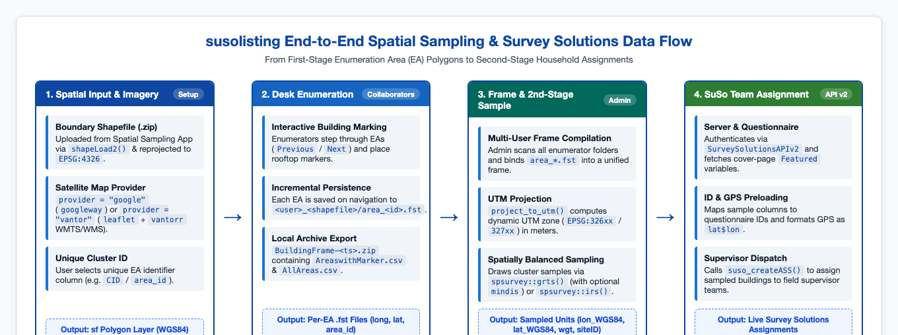
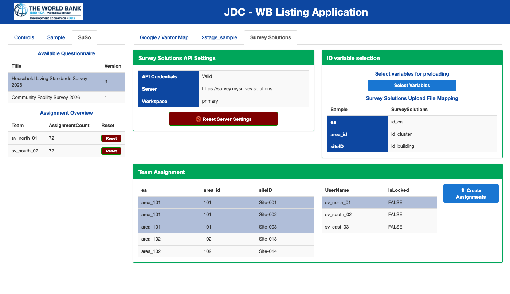

```{r, include = FALSE}
knitr::opts_chunk$set(
  collapse = TRUE,
  comment = "#>",
  out.width = "100%"
)
```

## End-to-End Architecture

`susolisting` bridges spatial sampling and CAPI field operations by connecting **first-stage Enumeration Area (EA) boundary shapefiles**, **desk enumeration on high-resolution satellite imagery**, **second-stage spatially balanced sampling (`spsurvey`)**, and **automated Survey Solutions assignment creation (`SurveySolutionsAPIv2`)**.

```{r flow-diagram, echo = FALSE, fig.cap = "End-to-end data flow across the four stages of the susolisting workflow.", fig.alt = "Four-stage data flow diagram from spatial input to Survey Solutions team assignment."}

```

---

## Stage-by-Stage Data Pipeline

### Stage 1: Spatial Boundary Input & Satellite Map Initialization

| Component | Function / Object | Input Format | Output / State |
|:---|:---|:---|:---|
| **Provider Resolution** | `resolve_map_provider()` | `provider = "google"` or `"vantor"` (`"maxar"`) | Sets `options(susolisting.provider = ...)` |
| **Boundary Upload** | `shapeLoad2()` | `.zip` containing `.shp`, `.shx`, `.dbf`, `.prj` | `sf` polygon object transformed to `EPSG:4326` (`boundaryFile()`) |
| **Cluster Identifier** | `areaIDs()` | User-selected column (`input$area_id`) | Validated vector of unique EA identifiers |
| **Map Canvas** | `googleway::google_map()` or `leaflet::leaflet()` + `vantorr::add_vantor_basemap()` | Google API key or Vantor WMTS/WMS API key | Interactive satellite map zoomed to `lgaSel()` |

---

### Stage 2: Building Enumeration & Incremental `.fst` Persistence

As an enumerator clicks building rooftops inside the active EA boundary (`lgaSel()`), the browser's custom drawing handler (`suso_drawing_js()`) places a marker and emits `input$detailSampMap_markercomplete`:

1. **In-Memory Collector (`pointsCollectorGoogle()`)**:
   Accumulates newly placed markers for the active Enumeration Area in a `data.table`:
   ```
   long (numeric) | lat (numeric) | area_id (character)
   ```
2. **On-Disk Persistence (`persist_area_points()`)**:
   Whenever the enumerator clicks **Next** (`input$loadNextEA`) or **Download Locations** (`input$downloadActivate`), the collected points are merged with any existing points for that EA and written to disk in fast binary `.fst` format:
   ```
   <app_download_dir>/<sanitized_user>_<shapefile_name>/area_<clean_id>.fst
   ```
3. **Individual Archive Export (`BuildingFrame-<timestamp>.zip`)**:
   When downloaded in local mode, the `.fst` files are combined into `AreaswithMarker-<timestamp>.csv` alongside the polygon attribute table `AllAreas-<timestamp>.csv`.

---

### Stage 3: Multi-Enumerator Frame Compilation & Second-Stage Sampling

In administrator mode (`modal_adminspsample_server()` and `modal_spsample2stage_server()`):

1. **Frame Compilation (`dt_frame()`)**:
   All `area_*.fst` files across all `<user>_<shapefile>` folders are read and bound via `data.table::rbindlist(..., idcol = "ea")`, sorted by `c("ea", "long", "lat")`.
2. **Dynamic UTM Projection (`project_to_utm()`)**:
   Before calling `spsurvey`, the WGS84 point frame is converted to an `sf` object and dynamically projected into the appropriate Universal Transverse Mercator (UTM) zone in meters:
   $$\text{Zone} = \left\lfloor \frac{\bar{\lambda} + 180}{6} \right\rfloor + 1$$
   producing `EPSG:326xx` (Northern Hemisphere) or `EPSG:327xx` (Southern Hemisphere). This ensures that spatial balance and minimum distance constraints (`mindis` in meters) are computed on planar metric coordinates.
3. **Sample Selection (`spsurvey::grts()` / `spsurvey::irs()`)**:
   For each stratum $h$ (cluster), the target sample size is capped at the cluster's building count ($n_h = \min(n_{\text{sample}}, N_h)$). The resulting `sites_base` `sf` object is transformed back to `EPSG:4326` (`sampleData()`), containing:
   - `siteID`: Unique sampled unit identifier generated by `spsurvey`
   - `ea` and `area_id`: Cluster identifiers
   - `lon_WGS84`, `lat_WGS84`: Geographic coordinates in decimal degrees
   - `wgt`: Design weight ($N_h / n_h$)
4. **Automated Word Sampling Report (`sampling_report_server()` / `build_sampling_report_docx()`)**:
   Alongside the zipped CSV sample download, the sampling module provides a dedicated `officer`-powered reporting module (`R/shiny_sampling_report_module.R`) that generates a World Bank Group-styled `.docx` report documenting the frame, the spatial sampling process and parameters, and the resulting sample diagnostics.

---

### Stage 4: Survey Solutions Variable Mapping & Supervisor Assignment

In the **SuSo** tab (`mapadminSRV_st2()`), the sampled building units are linked directly to a live Survey Solutions server via `SurveySolutionsAPIv2`:

```{r suso-assign-img, echo = FALSE, fig.cap = "Survey Solutions assignment interface showing API connection status, cover-page variable mapping, and supervisor team assignment tables.", fig.alt = "Survey Solutions assignment interface with API settings, variable mapping, and team assignment tables."}

```

1. **Server Authentication & Questionnaire Structure**:
   - `SurveySolutionsAPIv2::suso_set_key()` and `SurveySolutionsAPIv2::suso_PwCheck()` validate the server URL, workspace, API user, and password.
   - `SurveySolutionsAPIv2::suso_getQuestDetails()` retrieves the list of imported questionnaires. Selecting a questionnaire fetches its JSON structure (`operation.type = "structure"`) and extracts all cover-page identifying variables (`Featured == TRUE`):
     - Non-GPS variables (`IDVARS()`) for preloading cluster/building IDs.
     - The featured `GpsCoordinateQuestion` variable (`GPSVAR()`) for preloading building coordinates.
2. **Interactive Variable Mapping (`suso_map_idSRV()`)**:
   - Clicking **Select Variables** opens a modal where the administrator maps sample columns (e.g., `ea`, `area_id`, `siteID`) to the corresponding Survey Solutions cover-page variables (e.g., `id_ea`, `id_cluster`, `id_building`).
   - The `lon_WGS84` and `lat_WGS84` columns are automatically formatted into Survey Solutions' GPS preload string (`"<lat>$<lon>"` rounded to 8 decimal places) and bound to `GPSVAR()`.
3. **Supervisor Team Dispatch (`suso_createASS()`)**:
   - The administrator selects one or more sampled buildings (or clusters) in the left table (`assignTable`), selects a field supervisor in the right table (`teamTable`, populated via `SurveySolutionsAPIv2::suso_getSV()`), and clicks **Create Assignments**.
   - `susolisting` iterates over the selected units and calls `SurveySolutionsAPIv2::suso_createASS()` for each sampled building, assigning it to `ResponsibleName` with preloaded ID and GPS coordinates.
   - The **Assignment Overview** table in the left sidebar logs the number of assignments created per team and provides a confirmation-protected **Reset** button.
