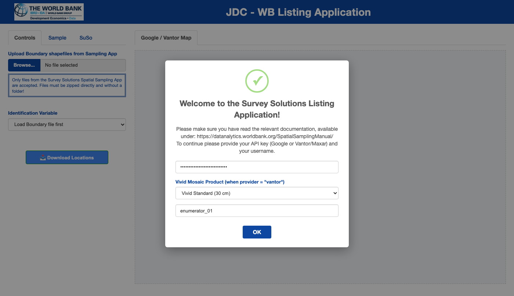
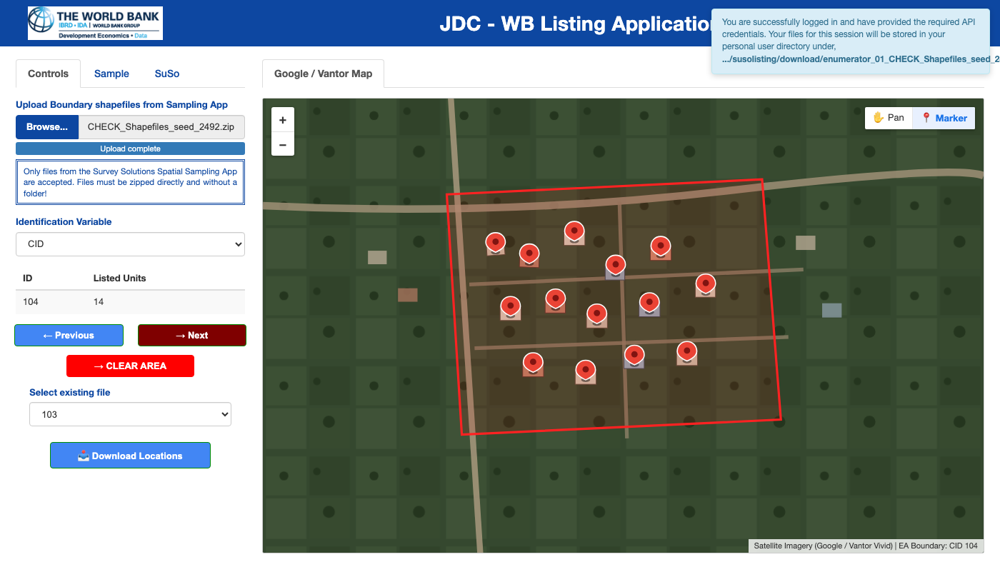

```{r, include = FALSE}
knitr::opts_chunk$set(
  collapse = TRUE,
  comment = "#>",
  out.width = "100%"
)
```

## Overview

The **Survey Solutions Listing Application** (`susolisting`) enables desk enumerators to build a complete second-stage sampling frame of buildings within first-stage Enumeration Areas (EAs). Starting from a zipped ESRI shapefile of EA boundary polygons (typically produced by the [JDC-Survey Solutions Spatial Sampling Application](https://github.com/michael-cw/susogrdframe)), enumerators step through each polygon on high-resolution satellite imagery and place a marker on every visible building rooftop.

The application supports two satellite imagery providers:

- **Google Maps (`provider = "google"`, default)**: Uses `googleway` to render Google Satellite imagery.
- **Vantor / Maxar Vivid Mosaic (`provider = "vantor"` or `"maxar"`)**: Uses `leaflet` and [`vantorr`](https://github.com/michael-cw/vantorr) to stream high-resolution (30 cm Standard or 15 cm Advanced) OGC WMTS/WMS satellite basemaps and optional seamline cutlines.

---

## 1. Starting the Application

To launch the application in **individual (local) enumerator mode**, run `runListingApp()` without administrator credentials:

```r
library(susolisting)

# Option A: Use Google Maps satellite imagery (default, 10x10 spatial coverage grid)
runListingApp(provider = "google", n_grid = 10L)

# Option B: Use Vantor / Maxar Vivid satellite imagery via leaflet + vantorr
runListingApp(provider = "vantor", n_grid = 10L)
```

The `n_grid` parameter (default `10L`) controls the resolution of the spatial polygon coverage check (`10 x 10` grid cells) performed when saving each Enumeration Area's building markers.

### Start-Up Authentication Dialog

When the browser opens, a modal dialog prompts you for your satellite API credentials and a **User Name**:

```{r startup-img, echo = FALSE, fig.cap = "Start-up modal dialog prompting for API credentials (Google or Vantor/Maxar) and the enumerator's User Name.", fig.alt = "Start-up modal dialog prompting for API credentials and enumerator User Name."}

```

1. **API Key / Credentials**:
   - When `provider = "google"`, enter your **Google Maps JavaScript API key**.
   - When `provider = "vantor"`, enter your **Vantor / Maxar API Key** (or leave blank if `VANTOR_API_KEY` or `MAXAR_API_KEY` is already configured in your `.Renviron`), choose the **Vivid Mosaic Product** (`VIVID_STANDARD_30` at 30 cm or `VIVID_ADVANCED_15` at 15 cm), and optionally provide OAuth2 credentials.
2. **User Name**:
   - Enter a unique identifier (e.g., `enumerator_01`). Punctuation and spaces are automatically sanitized.
   - All enumerated areas from your session are saved incrementally under your user-specific directory:
     `<R_user_dir>/susolisting/download/<User_Name>_<Shapefile_Name>/`.

---

## 2. Uploading the Boundary Shapefile & Selecting the Cluster ID

In the **Controls** tab on the left sidebar:

1. **Upload Boundary Shapefiles from Sampling App**:
   - Click **Browse...** and select the `.zip` archive containing your ESRI shapefile components (`.shp`, `.shx`, `.dbf`, `.prj`).
   - All shapefile component files must be zipped directly at the root of the `.zip` archive (not nested inside a subfolder).
   - If the shapefile uses a projected coordinate reference system, `susolisting` automatically transforms the boundaries to `EPSG:4326` (WGS84 longitude/latitude).
2. **Identification Variable**:
   - Once the shapefile is loaded, select the column that uniquely identifies each Enumeration Area (for example, `CID` or `area_id`).
   - If the chosen variable contains duplicate values across polygons, the application alerts you to select a unique identifier.
   - Selecting a valid identification variable renders the first Enumeration Area on the satellite map and reveals the navigation controls.

---

## 3. Marking Buildings on the Satellite Map

```{r listing-img, echo = FALSE, fig.cap = "Main enumeration interface showing the Controls sidebar, the active Enumeration Area boundary polygon (CID 104), 14 placed building markers, and the top-right Pan / Marker drawing control.", fig.alt = "Main enumeration interface with satellite imagery, EA boundary polygon, and building markers."}

```

### Using the Pan / Marker Control

In the top-right corner of the map canvas, a two-button control lets you switch between interaction modes:

- **Marker Mode (`📍 Marker`, active by default)**:
  - Your cursor changes to a crosshair (`+`).
  - Clicking anywhere inside the Enumeration Area places a building marker at that coordinate and immediately increments the **Listed Units** counter in the sidebar summary table.
- **Pan Mode (`✋ Pan`)**:
  - Temporarily disables marker placement so you can drag, pan, or inspect map overlays without accidentally placing a marker.
  - Note: You can also drag to pan the map directly while in **Marker** mode; only single clicks place markers.

### Navigating Across Enumeration Areas

- **Next (`Next →`)**:
  - Automatically saves all markers placed in the current Enumeration Area to disk as `area_<ID>.fst` inside your user folder, runs the **spatial polygon coverage check** (`calculate_polygon_coverage()`), clears the temporary marker buffer, and zooms the map to the next Enumeration Area polygon.
  - When you reach the final Enumeration Area in the shapefile, clicking **Next** saves the current area's markers, updates its spatial coverage metrics, and displays a confirmation notification.
- **Previous (`← Previous`)**:
  - Returns to the preceding Enumeration Area and reloads any previously saved markers (`house` layer) so you can review or add additional buildings.
  - Note: Once you place a new marker in the active area, the **Previous** button is disabled until you either advance with **Next** (saving the new markers) or click **CLEAR AREA**.
- **Select existing file**:
  - Dropdown menu listing all Enumeration Area IDs that have already been saved to disk. Selecting an ID jumps directly to that polygon and displays its saved markers.
- **CLEAR AREA**:
  - Removes all saved and unsaved building markers for the currently displayed Enumeration Area (deleting its `area_<ID>.fst` file) so you can re-enumerate the cluster from scratch.

### Spatial Grid Coverage Check (`AreaSummary`)

Whenever building markers for an Enumeration Area are saved by clicking **Next** (or **Download Locations**), `susolisting` evaluates how thoroughly the polygon area has been covered by point locations:

1. **Grid Overlay**: The active Enumeration Area polygon and its saved building coordinates are projected into planar UTM coordinates (meters), and an `n_grid x n_grid` spatial grid (`10 x 10` cells by default, configurable via `n_grid` in `runListingApp()`) is constructed over the polygon's bounding box and clipped to the cells intersecting the polygon interior.
2. **Coverage Percentage & Flagging**: The application calculates the percentage of polygon grid cells that contain at least one marked building (`coverage_pct`). Areas with coverage below **20%** are flagged with status **`LOW`**, while areas at or above 20% receive status **`OK`**.
3. **Sidebar Summary & Low-Coverage Alert**:
   - The sidebar **Area Summary** table displays four columns for the active cluster: **`ID`**, **`Listed Units`**, **`Coverage`** (e.g., `45.0%`), and color-coded **`Status`** (**`OK`** in green, **`LOW`** in bold red).
   - If saving an area results in `< 20%` spatial coverage, a warning notification alerts the enumerator to verify that all sections of the polygon have been listed.

---

## 4. Downloading the Completed Building Frame

When running in individual mode (`admuser = NULL`), the **Download Locations** button at the bottom of the **Controls** sidebar is enabled:

1. Clicking **Download Locations** first saves any unsaved markers from the currently active Enumeration Area (computing its spatial coverage metrics).
2. It compiles all `area_<ID>.fst` files from your session folder into a single `.zip` archive named `BuildingFrame-<YYYY-MM-DD_HH-MM-SS>.zip` containing two CSV files:
   - `AreaswithMarker-<timestamp>.csv`: Every marked building coordinate (`long`, `lat`, `area_id`) along with the cluster's spatial coverage percentage (`coverage_pct`) and status (`coverage_status`).
   - `AllAreas-<timestamp>.csv`: The attribute table of all Enumeration Areas from the uploaded boundary shapefile.
3. **Important**: After packaging the download archive, the individual `.fst` files in the working folder are flushed. Make sure you have completed all Enumeration Areas in your assignment and verified your downloaded `.zip` file.
